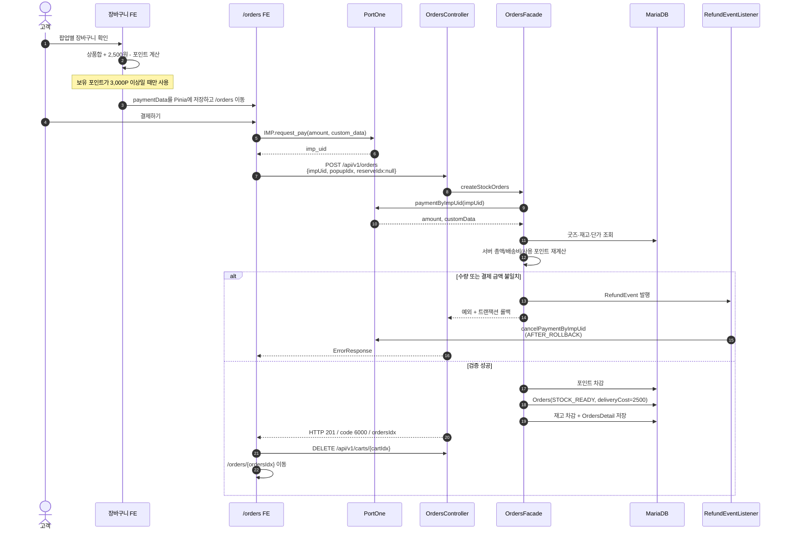
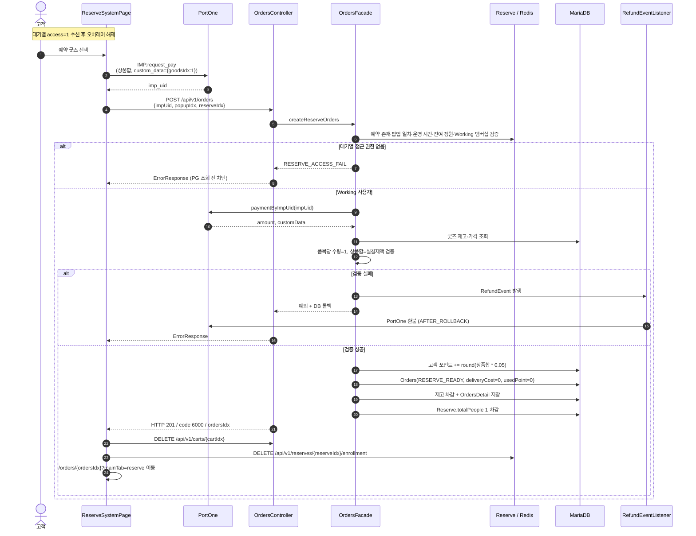
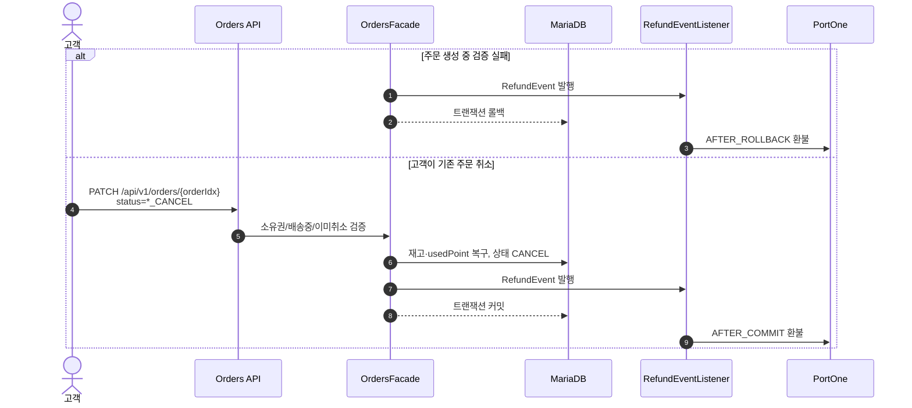

# ZIPPOP 기능 설명 및 개선

## 1. 재고 굿즈 결제

종료된 팝업의 남은 재고를 온라인으로 판매하는 흐름입니다. 장바구니는 팝업 단위로 생성되며, 프론트가 주문 요약을 Pinia에 저장한 뒤 `/orders`로 이동합니다.



| 항목 | 현재 서버 규칙 |
| --- | --- |
| 결제 분기 | `reserveIdx == null` |
| 배송비 | 2,500원 |
| 포인트 사용 | 보유 3,000P 이상, 사용량은 상품합 한도 |
| 포인트 적립 | 재고 주문에는 없음. FE도 적립 안내 없이 3,000P 이상 사용 조건만 표시 |
| 초기 상태 | `STOCK_READY` |

---

## 2. 예약 굿즈 결제

대기열의 Working 구간에 진입한 고객이 예약 굿즈를 현장 수령 조건으로 결제하는 흐름입니다.



| 항목 | 현재 서버 규칙 |
| --- | --- |
| 결제 분기 | `reserveIdx != null` |
| 수량 | 굿즈별 정확히 1개 |
| 배송비 / 수령 | 0원 / 현장 수령 |
| 포인트 | 사용 불가, 상품합 5% 적립 |
| 초기 상태 | `RESERVE_READY` |
| 자리 반환 | FE가 주문 성공 후 enrollment DELETE를 별도 호출 |

### 결제 검증 실패와 일반 주문 취소의 차이



`RefundEvent.rollbackOnly`로 생성 실패(`AFTER_ROLLBACK`)와 정상 취소(`AFTER_COMMIT`)를 분기합니다. 단, `AFTER_COMMIT` 이후 PortOne 호출이 실패하면 이미 커밋된 주문을 자동 재시도하지 않으므로 운영 단계에서는 outbox/재시도 또는 환불 상태 머신이 필요합니다.

---

## 3. 예약 대기열·승격·WebSocket

### 두 큐와 생성 시점

예약 슬롯(`Reserve`)은 `startTime`·`endTime`, `workingUUID`·`waitingUUID`를 저장합니다. `startDate` 필드는 없으며, 두 UUID를 각각 Redis ZSET 키로 사용합니다. 멤버는 고객 이메일, score는 등록·승격 시각의 밀리초 값입니다. Working은 굿즈 선택·결제에 들어갈 수 있는 접속큐이고, Waiting은 정원이 찼을 때 순번대로 기다리는 대기큐입니다. 정원은 `Reserve.totalPeople`입니다.

기업의 `POST /api/v1/reserves`는 팝업 소유권·상태·정원·예약 시간 범위를 확인하고 예약을 저장하면서 팝업 잔여 인원을 차감합니다. DB 커밋 뒤 `afterCommit`에서 두 큐의 `:deadline` 키와 종료 시각의 TTL을 설정합니다. ZSET 본체는 첫 멤버가 들어갈 때 만들어질 수 있습니다. `afterCommit`의 Redis 오류는 로그로만 남으므로 DB 저장과 큐 생성은 하나의 원자적 트랜잭션이 아닙니다. 기업의 예약 삭제도 DB 커밋 뒤 큐를 삭제합니다.

### 입장과 공정한 순번

고객의 `GET /api/v1/reserves/{reserveIdx}/enrollment`는 예약 시작 이후이면서 종료 전이고, 팝업이 진행 중이며, 예약 정원이 남아 있는지 검사합니다. 그다음 `ReserveRedisService.enrollWithLock` 한 번으로 기존 멤버 확인, Working의 10분 경과 멤버 정리, 대기자 우선 승격, 신규 등록을 처리합니다. 이미 Working이면 WTOKEN을 발급하고, 이미 Waiting이면 기존 순번을 반환합니다.

새 고객은 `lock:{workingUUID}` Redisson 락(`tryLock` 대기 최대 5초, lease 3초) 아래 `FAIR_ENROLL` Lua 스크립트로 입장합니다. 스크립트는 만료된 Working 멤버를 정리하고, 빈자리가 있으면 기존 Waiting의 앞순번을 먼저 Working으로 옮깁니다. Waiting이 비고 자리가 남을 때만 새 고객을 Working에 넣으며, 그 외에는 Waiting에 넣습니다. 이 ZSET 변경은 스크립트 한 번으로 실행됩니다. Working에 바로 들어간 HTTP 응답은 10분짜리 WTOKEN 쿠키와 Authorization 헤더를 설정합니다. 대기 고객에게는 순번만 반환합니다.

### 상태 확인과 승격

프론트엔드는 입장 API 호출 뒤 SockJS `/ws`로 STOMP에 연결하고 `/user/queue/reserve/status`를 구독합니다. 접속 직후와 10초마다 `/pub/reserve/status`에 `reserveIdx`를 보내면 서버가 해당 사용자에게 Working·Waiting 인원, 현재 순번, `access`를 보냅니다. `global.security.socket`의 handshake·인증 인터셉터가 접속 사용자를 확인하고, `reserve.infrastructure.stomp.ReserveStompInterceptor`가 예약 메시지 경로를 제한하며 `SEND` 시 `ReserveStompSession.bind`로 세션을 예약 ID와 이메일에 묶습니다. 같은 세션에서 다른 예약으로 바꾸는 요청은 거부합니다. Working 상태와 승격 알림에는 WTOKEN과 `accessExpiresAt`도 포함됩니다. 프론트엔드는 만료 시각에 접속권을 해제하고, 같은 상태의 반복 폴링으로 토스트가 계속 뜨지 않게 처리합니다.

HTTP 취소와 마지막 WebSocket 세션 종료는 모두 `ReserveService.leaveQueue`를 호출합니다. Working 사용자는 큐에서 제거하고 Waiting의 첫 사용자를 승격시키며, Waiting 사용자는 대기큐에서만 제거합니다. 승격은 등록과 같은 `lock:{workingUUID}` Redisson 락과 `PROMOTE` Lua 스크립트로 정원·deadline을 확인하면서 Waiting 제거와 Working 추가를 한 번에 처리합니다. 승격된 고객에게 `/queue/reserve/status`로 `access=1`, WTOKEN, `accessExpiresAt`을 푸시합니다. HTTP 취소는 Working에서 나왔을 때 WTOKEN 쿠키를 만료시킵니다. `ReserveStompSession`은 동일 이메일·예약의 마지막 소켓이 끊겼을 때만 큐 이탈을 요청하며, 세션 맵의 삭제·마지막 연결 판정만 동기화합니다. DB 조회와 Redis 처리는 이 잠금 밖에서 실행합니다.

`ReserveScheduler`에는 서울 시간 기준 10초마다 실행되는 큐 관리 작업과 매분 정각에 실행되는 승격 작업이 별도로 있습니다. 큐 관리 작업은 종료된 예약·팝업의 큐 삭제, 진행 중인 예약의 Working 만료자 제거, 누락된 `:deadline` 키 재생성을 맡습니다. 승격 작업은 진행 중인 예약만 조회해 빈자리만큼 Waiting 사용자를 Working으로 옮기고 소켓으로 통지합니다. 두 작업의 실행 순서는 보장되지 않지만 승격 Lua 스크립트도 만료자를 정리하고 deadline을 검사합니다. Redis에서 멤버 데이터 자체가 사라졌다면 기존 순번은 복원하지 못합니다.

예약 굿즈 주문은 서버에서 Working 멤버십과 10분 접속 유효시간을 다시 검사합니다. 따라서 화면의 `access=1`만으로 주문을 허용하지 않습니다.

### access 상태

| access | 의미 | FE 동작 |
| --- | --- | --- |
| 0 | Waiting | 대기 오버레이 유지 |
| 1 | Working | 오버레이 해제, 굿즈 선택·결제 |
| 2 | 예약 종료 시간 경과 | 안내 후 홈으로 이동 |
| 3 | `Reserve.totalPeople <= 0` 마감 | 안내 후 홈으로 이동 |
| 4 | Working·Waiting 모두 미가입 또는 접속 유효시간 만료 | 대기 오버레이와 만료 안내 표시 |

### 이탈 경로

| 경로 | 처리 |
| --- | --- |
| 예약 취소 버튼 | STOMP disconnect 후 enrollment DELETE |
| `beforeunload` | `keepalive` DELETE |
| Vue Router guard | 예약 흐름 이탈 시 confirm 후 DELETE |
| `ReserveStompSession` 연결 종료 이벤트 | 세션에 연결된 예약 한 건을 찾아 마지막 소켓 이탈 시 `ReserveService.leaveQueue` 호출 |
| 결제 성공 | 장바구니 삭제 후 enrollment DELETE |

---

## 4. 검증 결과

| 검증 범위 | 결과 | 확인 내용 |
| --- | --- | --- |
| 백엔드 단위·컨텍스트 테스트 | 통과 | 26개: 요청 검증, 장바구니 중복, 좋아요 삭제, 리뷰 자격, 예약 시간/큐 복구, 주문·환불, 로그아웃, 미존재 경로 404 포함 |
| 프론트엔드 단위 테스트 | 통과 | 41개: API 계약, 오류 처리, 라우터 메인 탭, Pinia 전체 스토어 엔드포인트 |
| 정적·번들 검증 | 통과 | ESLint, Vue production build |
| Docker 서비스 | 통과 | MariaDB·Redis healthcheck, backend healthy, frontend 기동 |
| 공개 API smoke | 통과 | 팝업·재고 굿즈·예약 목록 HTTP 200 |
| 공개·고객·기업 읽기 API smoke | 통과 | 팝업/굿즈 상세, 리뷰/예약, 계정/장바구니/주문/좋아요, 기업 정산 등 15/15 HTTP 200 |
| 실제 쓰기 CRUD | 통과 | 팝업·굿즈·예약 생성/수정/삭제, 좋아요 왕복 토글, 장바구니 생성·중복 차단·수량·삭제 18/18 |
| 3사용자 실제 대기열 | 통과 | 시작 전 400, 등록 200/200/200, Working/Waiting `2/1`, 취소 후 `2/0`, 첫 대기자 승격 확인 |
| 실제 WebSocket 사용자 푸시 | 통과 | 인증 STOMP 연결 후 `/user/queue/reserve/status`에서 승격 `access=1`과 WTOKEN 수신 |

대기열 검증은 테스트 예약을 생성해 두 차례 재현했고 매 실행 후 DELETE 200으로 제거하여 팝업 정원을 복구했습니다. CRUD용 데이터도 API 삭제 후 소프트 삭제된 테스트 팝업 행만 식별자를 검증해 물리 정리했습니다. PortOne 실결제/실환불은 외부 샌드박스 거래를 만들지 않고 `IamportClient` mock 기반 계약 테스트로 검증했습니다.

---

## 5. 현재 보장과 잔여 과제

| 우선순위 | 현재 구현 | 위험 | 권장 방향 |
| --- | --- | --- | --- |
| P1 | 일반 취소는 `AFTER_COMMIT`, 생성 실패는 `AFTER_ROLLBACK`으로 환불 | 커밋 후 외부 PG 장애 시 자동 재시도 없음 | outbox + 멱등 재시도 또는 `REFUND_PENDING` 상태 도입 |
| P1 | 신규 등록·승격은 같은 Redisson 락과 각각의 Lua 스크립트로 처리하며, HTTP 취소·소켓 이탈은 `leaveQueue`를 공유 | Working 멤버 확인·제거와 이후 승격·알림은 별도 호출이므로 중간 실패 시 알림이나 빈자리 처리 지연 가능. 승격 스크립트는 정원을 다시 검사하고 승격 스케줄러가 빈자리를 보충 | 중간 실패의 재시도·상태 재확인 경로 검토 |
| P1 | WebSocket disconnect 즉시 큐 제거·승격 | 일시적인 네트워크 끊김에도 사용자가 자리를 잃을 수 있음 | 재접속 유예 시간과 heartbeat 기반 만료 정책 도입 |
| P2 | WTOKEN/JWT 만료와 Working 접속권을 10분으로 설정 | 설정값이 여러 호출부에 분산 | 공통 Duration 설정으로 단일화 |
| P2 | 스케줄러가 시작된 예약의 누락된 deadline 키를 DB 기준으로 재생성 | Redis 멤버 데이터가 소실되면 기존 대기 순서는 복원 불가 | 필요 시 큐 이벤트 영속화 또는 Redis AOF 운영 정책 명시 |
| P2 | 예약 생성·삭제의 Redis 처리는 DB 커밋 뒤 실행 | Redis 작업 실패 시 DB와 큐 상태가 일시적으로 달라질 수 있음 | 실패 작업 재시도 및 운영 알림, 삭제 큐 정합성 점검 |

수정 완료된 항목은 예약 주문의 유효한 Working 멤버십 서버 검증, 표준 `/user/queue/reserve/status` 구독과 `/queue/reserve/status` 발행, 등록·승격의 공용 락과 Lua 처리, 소켓 세션별 이탈 추적, WTOKEN 10분 설정, 누락된 deadline 키의 재생성, 두 큐 미가입 사용자에 대한 `access=4` 응답입니다.

---

## 6. 전체 흐름 요약

```text
[기업] 팝업·예약 슬롯·굿즈 등록
          │
          └── Redis Working / Waiting 큐 (슬롯별 TTL)
                    │
[고객] enrollment ─────► Working 또는 Waiting
                    │           │
               STOMP 상태      └── access=1 ► 예약 굿즈 결제
                    │                              │
        이탈/결제 성공 ─────────────────┘
                    │
             Waiting 1순위 승격 + 유저 소켓 푸시

[재고 마켓] 장바구니 ► /orders ► PortOne ► 서버 재검증 ► STOCK_READY
[예약 굿즈] access=1 ► PortOne ► 서버 재검증 ► RESERVE_READY ► 자리 반환
```

포트폴리오의 핵심은 **Redis ZSET 이중 큐, 등록·승격에 쓰는 Redisson 락과 Lua, STOMP 유저 푸시, 서버 측 Working 인가, PG 결제 재검증, 트랜잭션 결과에 따른 보상 환불**입니다. 운영 전에는 외부 PG 실패 재시도와 큐 이탈·승격 사이의 실패 복구를 보강해야 합니다.

## 구현상 주의사항

| 영역 | 현재 구현 | 영향 |
| --- | --- | --- |
| 성공 코드 | 6015, 7008 등 Enum 코드가 중복되고 기업 예약 목록이 취소 메시지를 사용 | 소비자는 `code`만으로 세부 행위를 구분하지 말 것 |
| 대기자 승격 | enrollment·승격의 ZSET 변경은 같은 Redisson 락 아래 각각 Lua 스크립트로 실행 | 이탈자의 Working 제거와 승격·소켓 통지는 별도 단계이므로 실패 시 재점검 필요 |
| 주문 취소 환불 | 정상 취소는 `AFTER_COMMIT`, 생성 실패는 `AFTER_ROLLBACK`에서 환불 | 커밋 후 PG 장애에 대한 outbox·멱등 재시도 없음 |
| 소켓 이탈 | `ReserveStompSession`이 마지막 연결 종료 시 `ReserveService.leaveQueue`를 호출 | 일시적 네트워크 단절에도 자리를 잃을 수 있어 재접속 유예 정책 권장 |
| Page 직렬화 | `PageImpl`을 직접 응답 | 외부 API 안정성을 위해 DTO/PagedModel 고정 권장 |

### 원본 검증 기록

- OpenAPI: 44 operations
- 백엔드 테스트: 26/26 통과
- 프론트엔드 테스트: 41/41 통과, ESLint·production build 통과
- Docker 읽기 API smoke: 15/15, 실제 쓰기 CRUD: 18/18 통과
- 3사용자 대기열: Working/Waiting `2/1` → 취소 후 `2/0`, 대기자 승격 확인
- 인증 STOMP: `/user/queue/reserve/status`에서 `access=1`과 WTOKEN 수신 확인
- PortOne 실결제/실환불, 이메일, S3는 외부 실연동 대신 mock·코드 계약으로 검증

## 회원 가입 성능 개선
- 동기 방식으로 이메일 전송 -> 비동기 방식의 이메일 전송으로 수정<br>
- 기존 방식 : 4s / 개선 방식 : 0.2s => 결과 : 95% 향상


## 레디스를 이용한 이메일 인증 유효시간 설정
- 기존의 이메일 인증 방식은 유효시간 설정 없이 링크만 클릭하면 인증되는 구조<br>
- 레디스를 이용해 만료시간(3분)을 설정


## 리프레시 토큰 도입 및 테스트
- 리프레시 토큰 발급 및 저장 확인 


- 액세스 토큰 만료 후 갱신 테스트 (만료시간 1분)


